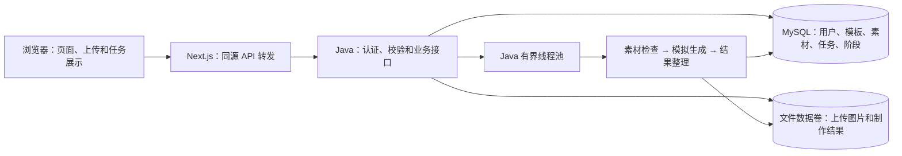
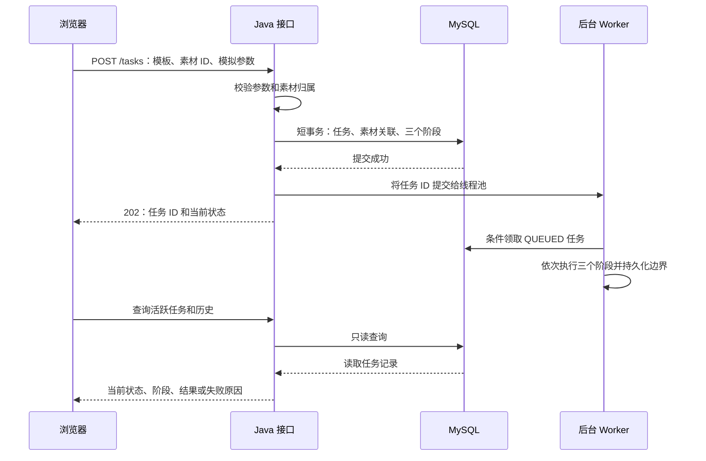

# 素作：项目说明与设计思路

本文说明已经实现的业务流程、关键设计选择及边界。启动配置见 [README](../README.md)，联调字段见 [接口契约](api-contract.md)，测试命令见 [边界测试](boundary-tests.md)。

## 1. 项目要解决什么问题

素作是一个素材制作网站。用户注册登录后，可以浏览分类模板、上传图片、提交制作任务，在后台处理期间继续浏览网站，最后查看个人历史和制作结果。

本项目不调用真实 AI。生成过程用可控制的阶段延迟、指定阶段失败和本地预置图片模拟。这样可以重复验证任务排队、处理中、成功、失败、刷新恢复等业务行为，把实现重点放在异步执行与状态一致性上。

完整用户路径是：

```text
注册／登录 → 选择模板 → 上传素材 → 提交任务 → 后台持续处理 → 查看结果／失败原因
                                                ↓
                                      继续浏览、创建其他任务
```

## 2. 为什么采用这套架构

前端使用 Next.js App Router、React 和 TypeScript；后端使用 Java 21、Spring Boot、Spring Security、MyBatis；数据库使用 MySQL。具体版本锁定在依赖文件及 README。



Java 是业务状态的来源，Next.js 只负责页面与同源转发。任务创建、用户隔离、后台执行和持久化都在 Java 中完成。因此，关闭页面不会停止任务，刷新页面也不需要依赖浏览器保存一份任务历史。

同源 `/api` 转发让 Cookie、CSRF 和图片访问保持一致，减少跨域认证配置。它没有把业务逻辑搬到 Next.js。

当前场景是单实例、可控耗时的演示任务，有界线程池和轮询足以完成要求。引入消息队列、Redis 或推送连接，会增加额外组件及恢复逻辑；这些不是完成当前业务闭环的必要条件。

## 3. 后端如何受理并持续执行任务

### 3.1 把“受理”与“制作完成”分开

提交接口先检查模板、素材数量、重复素材、文件存在性、用户归属和模拟参数，然后在短事务中创建：

- `creation_tasks`：总体任务及模拟配置快照，初始状态为 QUEUED。
- `task_assets`：素材与上传槽位的对应顺序。
- `task_step_runs`：三个阶段的初始 PENDING 记录。

当前调用路径中，`TransactionTemplate.executeWithoutResult` 返回时事务已经提交，再把任务交给线程池。这样 Worker 不会读取尚未提交的任务。

接口返回 `202` 和任务 ID，不等待制作结束。Worker 可能已经开始执行，所以前端按响应中的实际状态展示，不假设返回的一定是 QUEUED。



Worker 与 HTTP 响应可以并发发生。页面关闭只会停止浏览器请求，不会取消已交给 Java 的后台工作。

### 3.2 总体状态与阶段分别表达

总体状态回答“任务是否结束”，阶段回答“处理到了哪里”。

| 类型 | 状态 |
| --- | --- |
| 总体任务 | QUEUED、RUNNING、SUCCEEDED、FAILED |
| 当前阶段 | MATERIAL_CHECK、MOCK_GENERATION、RESULT_PACKAGING，可为空 |
| 阶段记录 | PENDING、RUNNING、SUCCEEDED、FAILED、SKIPPED |

执行顺序固定为素材检查、模拟生成、结果整理。阶段开始时保存当前阶段和 RUNNING，阶段结束时保存结果及时间。延迟发生在事务之外，不长时间占用数据库事务。

`Pipeline` 只负责阶段顺序；`TaskService` 负责状态持久化、阶段工作和错误处理。这样的划分让顺序与失败中断可以独立测试，同时用真实 MySQL 集成测试验证持久化结果。

### 3.3 失败会停止后续阶段

例如指定模拟生成失败：

```text
任务：FAILED，失败阶段：MOCK_GENERATION
素材检查：SUCCEEDED
模拟生成：FAILED
结果整理：SKIPPED
```

异常被后台服务捕获，保存错误码、原因和结束时间，再将未开始阶段置为 SKIPPED。不会继续整理结果。查询接口只读取这些记录，不通过查询次数推进阶段。

成功时先生成任务专属的结果文件，再在数据库事务中将整理阶段和总体任务置为成功。文件先写入临时路径，再移动到正式路径，减少预览到半个文件的可能。文件系统与 MySQL 之间并没有分布式事务，这也是当前单实例实现的边界。

### 3.4 队列满和重启都有明确行为

默认两个线程、50 个队列位，均可配置。队列容量有限，避免任务无限进入内存。调度被拒绝时，已经创建的任务保存为 FAILED / EXECUTOR_REJECTED，未开始阶段为 SKIPPED；接口仍返回可查询的任务 ID。

线程池不是持久化执行队列。数据库记录提交之后、任务入队之前也存在进程故障窗口。因此，本项目没有声称实现可靠投递、自动续跑或 exactly-once 执行。

服务启动时会把遗留的 QUEUED／RUNNING 任务标为 FAILED / SERVICE_RESTARTED，保留已知阶段和可理解的中断原因，避免历史永久显示处理中。已成功任务及图片保持不变。这一策略依赖单实例部署，不适用于多个实例共同执行同一批任务。

## 4. 为什么前端需要区分三类状态

页面最容易出错的地方，是把一次请求的失败当成后台制作失败。实现中分开保存以下信息：

| 类别 | 示例 | 信息来源 |
| --- | --- | --- |
| 页面交互 | 上传中、上传失败、提交中 | 当前上传／提交请求 |
| 后台任务 | 等待、处理中、成功、失败及阶段 | Java 返回的任务对象 |
| 查询情况 | 暂时无法刷新、部分任务查询异常 | 查询请求本身 |

素材未准备好或提交中时禁用提交；受理成功后结束“提交中”，添加任务卡片，用户可以继续创建其他任务。

查询临时失败时保留上次任务状态，显示查询异常并允许恢复。只有后端任务对象明确返回 FAILED，页面才显示制作失败。提交请求中断则提示先查看历史，因为服务器可能已经创建任务；没有幂等机制时不自动重发。

## 5. 多任务轮询如何避免互相影响

前端分工如下：

- TanStack Query 管理模板、详情和历史等查询缓存。
- `TaskTracker` 按任务 ID 保存状态，处理活跃任务、终态合并和查询异常。
- `TaskProvider` 管理当前登录用户的轮询、窗口聚焦／联网事件和清理生命周期。

登录后先读取 `/tasks/active`。只要存在未完成任务且没有查询异常，就约每两秒更新一次。一次刷新尚未结束时，不再发起重叠刷新。

活跃列表只包含 QUEUED／RUNNING。一个原本活跃的任务从列表消失时，前端再查询它的详情，取回成功结果或失败原因。取回终态后停止跟踪该任务；所有任务结束后清理计时器。重新聚焦或恢复网络仍可以重新核对服务端状态。

多个消失任务的详情查询使用 `Promise.allSettled`：某个查询失败时，其他任务仍能正常更新。失败查询对应的任务保留原信息，显示查询异常，恢复时继续查询。已经保存的终态不会被迟到的处理中响应覆盖。

刷新页面后重新读取 Java 的个人历史和活跃任务；不通过 localStorage 假造业务记录。离开制作页后，全局任务跟踪仍可继续，以支持浏览其他页面；页面上传请求会取消。退出用户或卸载全局 Provider 时清理请求、计时器和事件订阅。

## 6. 身份隔离与迟到响应

用户名归一化并保持唯一；密码使用 BCrypt 哈希。登录身份使用 Java Session 和 HttpOnly Cookie，写请求要求 CSRF Token。登录轮换 Session ID，退出销毁会话，修改密码使现有会话失效。

后端从当前会话取得用户 ID，素材、任务和结果都校验归属。前端隐藏他人的入口不是权限控制；直接请求他人的资源也会返回 404。

前端还需要处理一种竞态：A 的请求尚未返回时退出，再登录 B；A 的旧响应随后返回 401。如果无条件广播会话失效，就会错误清除 B 的身份。

为此，API 客户端维护认证代际，在身份边界变化时更新代际，并在读取响应时检查请求是否仍属于当前身份。同时使用 AbortController、用户维度的查询缓存和 Provider 生命周期清理。旧响应既不能写入新用户任务，也不能使新用户被错误退出。

## 7. 素材与模拟结果为什么这样实现

模板来自数据库种子数据，通过 Java 接口提供，覆盖三个分类与一张、两张、三张图片要求。封面、示例 PNG 和结果 SVG 随项目交付。

每个上传槽位独立管理预览、替换、移除、上传中和上传失败。浏览器临时 URL 只用于预览；创建任务提交的是后端素材 ID，后台实际读取服务器文件。

Java 校验图片实际可解码格式、文件大小和尺寸，使用随机文件名存储，避免把用户原文件名作为路径。任务提交时再次检查归属与文件存在性。

每个任务保存自己的延迟和失败阶段快照，避免全局模拟开关在多个任务间互相干扰。默认演示成功，也可以确定性地触发任意阶段失败。成功结果是复制预置图片到任务专属目录，不声称进行了真实 AI 或图片合成。

## 8. 如何证明这些设计在运行中成立

验证分为单元测试、真实数据库集成、真实 HTTP 和进程级检查。

| 检查 | 关注点 |
| --- | --- |
| Java：15 个测试 | 阶段顺序、失败中断、快速受理、权限、队列满、并发配置、分页、文件与输入边界 |
| 前端：10 个测试 | 多任务独立、查询失败与任务失败区分、轮询停止、恢复、卸载取消、身份切换 |
| HTTP smoke | 经 Next.js 转发完成注册、登录、上传、后台成功／失败、结果、隔离和历史恢复 |
| SIGKILL 重启 | 在独立环境强制结束 Java，验证处理中／排队任务中断，成功图片和历史保留、旧会话失效 |

队列测试使用同步闸门阻塞真实结果整理，确定性构造“一个运行、一个排队、第三个拒绝”，不依赖猜测线程启动时间。

分页测试建立 123 条相同创建时间的记录，验证次级 ID 排序、跨页无遗漏无重复、尾页／空页、模板过滤和用户隔离。前端轮询测试使用假时钟，直接验证请求是否停止。

边界测试还发现了非数字分页参数被误报为 500 的问题。先运行失败用例，再增加明确的参数绑定异常处理，最终返回 400 / VALIDATION_ERROR，并通过真实 HTTP 验证部署结果。

源码功能基线 `c2ae41a788f2600b14e147ff11e1c4fd813ebb74` 的 GitHub Actions 已成功完成 frontend、backend 和 restart-boundary 三项检查，记录见 [Checks](https://github.com/Nicco-zxw/xiaoyin/actions/runs/40827771643)。后续提交的 CI 状态以仓库 Actions 为准。

## 9. 工程交付与已知取舍

Docker Compose 提供前端、Java、MySQL 和持久化文件卷。Flyway 初始化结构及演示模板。前端等待 Java 就绪，Java 等待 MySQL 健康检查；应用安装、构建与验证均有容器入口。

当前明确保留的限制：

- Session 与执行器均为单实例内存实现；重启需重新登录，未完成任务不续跑。
- 没有提交幂等、自动重试和断点恢复；请求结果未知时先查询历史。
- 未引用上传文件不自动清理；文件与数据库没有跨系统原子提交。
- 尚未演练生产部署／备份回滚，没有公网部署或负载压测。
- Flyway 对 MySQL 8.4 有版本验证范围提示；实际迁移和集成检查通过，提示保留在验证记录中。

若继续演进，优先考虑受理幂等、文件清理和任务可靠恢复，再根据实际吞吐量选择持久队列与独立 Worker。增加重试前，应先定义各阶段的幂等和副作用边界。多实例部署还需要替换当前全局重启中断策略及内存会话方案。

## 10. AI 参与方式与评审阅读顺序

项目使用 Codex 辅助开发。先把需求整理为设计与接口契约，再按身份、素材、后台任务、前端跟踪和工程交付拆分；生成和修改代码后，在容器中通过测试、构建和浏览器核对结果。没有复用其他网站的业务源码；图片为项目内程序绘制素材。

AI 输出不直接视为验证结论。例如独立审查指出身份切换竞态后，先构造旧请求迟到的失败断言，再加入认证代际与取消保护，运行回归测试；边界补齐时也按同样方式修复了 400／500 分类问题。

建议评审先运行一次成功与指定失败，再阅读以下入口：

1. [TaskService](../backend/src/main/java/studio/TaskService.java)：受理事务、执行器、状态和阶段持久化。
2. [Store](../backend/src/main/java/studio/Store.java) 与 [数据库结构](../backend/src/main/resources/db/migration/V1__schema.sql)：查询与条件状态更新。
3. [TaskTracker](../frontend/src/lib/tracker.ts) 与 [TaskProvider](../frontend/src/components/tasks.tsx)：多任务合并和轮询生命周期。
4. [API 客户端](../frontend/src/lib/api.ts)：请求异常、CSRF 和身份代际。
5. [后端边界测试](../backend/src/test/java/studio/BoundaryIntegrationTest.java)、[前端生命周期测试](../frontend/src/components/tasks.test.tsx) 与 [重启检查](../infra/restart-smoke.mjs)：上述设计的运行证据。

演示、配置与部署命令以 README 为准；此文解释设计原因，不替代接口契约或测试记录。
